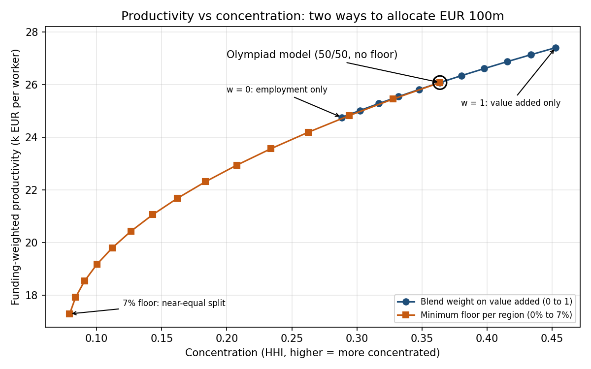

# Regional Fund Allocator

How should a Finance ministry split €100m across Greece's 13 regions? This project aims to compare 5 different allocation rules, measures how concentrated each is, stress-tests them against potential data error, and backtests them against real-world events and data that took place.

Answer for the final of the **Hellenic Statistics Olympiad 2026**. The task was to propose a funding rule for the trade sector (NACE Sector Ζ, wholesale and retail trade).   


*Image: Scatter graph showing funding-weighted productivity (€k per worker) against concentration (HHI) for 26 allocations of the €100m budget, generated by varying the blend weight from 0 to 1 (blue) and the minimum floor per region from 0% to 7% (orange).*

## What it does

| Stage | Question | Method |
|---|---|---|
| 1. Compare rules | What region receives what share of the budget under each rule? (value added share, employment share, 50/50 blend, blend with a minimum floor for each region, equal split) | Five allocation rules, compared on HHI and effective regions |
| 2. Sensitivity sweep | What does diversification cost? | Identify concentration (HHI) against funding-weighted productivity |
| 3. Monte Carlo | Which results remain robust when checking data error? | 10,000 runs with 5% assumed measurement error on ELSTAT's estimates; 90% intervals and rank stability per region |
| 4. Backtest | Would any rule have picked the regions that grew in real-time? | Rules built on 2021 data only that were scored on 2021 to 2023 growth with Spearman rank IC as well as a permutation test |

## The five allocation rules and what they do

Each rule (method to distribute budget) is essentially a different way of using the regional data to distribute a share of the €100m budget to every region. Every rule assigns a weight between 0 and 1 to the regions, and the weights always add up to 1, so for example a weight of 0.05 means €5m.

1. **Value added share.** Each region gets the same percentage of the budget as its share of the sector's value added, i.e. the wealth the sector creates. Thus, a region producing 10% of the value added gets 10% of the money.
2. **Employment share.** Each region gets the same percentage as its share of the sector's total employment. Similar to rule 1 but using a different metric.
3. **50/50 blend** Each region gets a weighted mix of rules 1 and 2. A weight greek letter α decides how much counts towards value added, and the rest (1 − α) counts towards employment. At α = 0.5, each region gets the average of its two shares.
4. **Blend with a minimum floor.** Every region is first guaranteed a minimum share of 2%, and the rest of the budget is split using the 50/50 blend. With 13 regions, a 2% floor guarantees 26% of the budget, and the remaining 74% follows the blend. This rule aims to address the potential widening of regional income and wealth inequality.
5. **Equal split.** Every region gets 1/13 of the budget (€7.69m each). It ignores the data completely, making it the benchmark that every other rule is compared against.

## Methodology

**Concentration (HHI).** To measure how concentrated each split is, I used the Herfindahl-Hirschman Index: square each region's weight and add them up. It ranges from 1/13 ≈ 0.077 (everyone gets the same) to 1 (one region gets everything). Since a number like 0.364 is hard to picture, I also report the effective number of regions, which is 1 ÷ HHI. It tells you how many equally funded regions the split behaves like.

**Sensitivity sweep.** I reran the model many times while changing one setting in small steps (the blend weight from 0 to 1, and the minimum floor from 0% to 7%), and recorded the HHI and the funding-weighted productivity each time. This shows how much productivity is lost as the money gets spread more evenly.

**Monte Carlo simulation.** ELSTAT only surveys large firms and estimates the rest, so its figures contain some error. To test how much that matters, I multiplied every figure by a small random factor, (1 + 0.05 × Z) where Z is drawn from a standard normal distribution, so most changes are within ±10%. I then reran the 50/50 blend on this noisy data, and repeated the whole process 10,000 times. For each region I recorded the range covering the middle 90% of its funding amounts, and how often it kept its original rank. If a result barely changes across 10,000 slightly different versions of the data, it can be trusted.

**Backtest and information coefficient (IC).** To see whether any rule would have backed the right regions, I built each rule using only 2021 data and compared its weights with how much each region actually grew by 2023. The IC is the Spearman rank correlation between the two: it compares the ranking of regions by weight with the ranking by growth. +1 means the orders match perfectly, 0 means no relationship, and −1 means they are exact opposites.

**Permutation test.** With only 13 regions, a decent-looking IC can appear purely by luck. To check, I shuffled the growth figures randomly between the regions 10,000 times and recalculated the IC each time. The p-value is the share of shuffles that produced an IC at least as strong as the real one. A p-value below 0.05 would suggest the result is unlikely to be chance; every rule here came out above 0.1.

## Key findings

**1. The first rule is highly concentrated.** Attica receives €57.55m. The allocation behaves like only 2.7 equally funded regions (HHI 0.364).

| Rule | Attica | North Aegean | HHI | Effective regions |
|---|---|---|---|---|
| Value added share | €65.36m | €0.58m | 0.453 | 2.2 |
| Employment share | €49.73m | €1.16m | 0.288 | 3.5 |
| 50/50 blend | €57.55m | €0.87m | 0.364 | 2.7 |
| 50/50 blend + 2% floor | €44.58m | €2.65m | 0.234 | 4.3 |
| Equal split | €7.69m | €7.69m | 0.077 | 13.0 |

2. Spreading the money more evenly resulted in losses in productivity. If every region is guaranteed at least 2% of the budget, the split goes from behaving like 2.7 equally funded regions to 4.3. So, the downside is that more money ends up in regions where each worker produces less, so the average productivity of the funded regions falls from €26.1k to €23.6k per worker, a drop of approx. 10%. Therefore, I tried two different ways of spreading the money out: one was through shifting the 50/50 blend towards employment, and the other was again adding a minimum floor for every region, this time anywhere from 0-7%. Over the range where both methods work, they cost almost exactly the same amount of productivity, so consequently neither is more efficient than the other; the difference comes how far each method can go, as shifting the blend can only spread the money as far as the employment-only split, whereas the floor can keep going until every region gets almost the same amount.

4. Only the top three positions retain their position; I added a 5% random error to ELSTAT's figures and reran the model 10,000 times. Attica, Central Macedonia and Crete stayed in the same place every single time. Below them, however, it got messy. Thessaly only held 5th place in 43% of runs, because the gaps between the mid-sized regions are smaller than the error in the data itself.
  
5. No rule stood out in the backtest. I built each rule on 2021 data and checked it against what actually happened by 2023. On value added growth, every size-based rule did 8 to 13 points worse than simply splitting the money equally. Most of that gap comes from the islands bouncing back after losing their tourism during Covid. On employment growth it went the other way, and the size-based rules came out slightly ahead. None of the ICs were significant, since every p-value was above 0.1. That isn't surprising with only 13 regions and one time period, as you'd need an |IC| of ~0.56 just to reach 5% significance. The sample size simply isn't enough to tell the rules apart and decide which is best.

6. The official data had a problem. ELSTAT's 2022 figures show negative Sector Ζ value added for Central Greece (−€676m) and the Ionian Islands (−€124m). Shares and growth rates mean nothing with a negative base, so the code throws an error instead of returning nonsense. That's why the backtest starts from 2021 and skips 2022.

## Project structure

```
src/allocator/
├── Main.java                  runs all four stages
├── model/                     RegionData, Metric, Dataset, Allocation
├── strategy/                  AllocationStrategy (interface) and its implementations
├── analysis/                  SensitivitySweep, MonteCarloSimulator, Backtester, RankCorrelation
└── io/                        CsvLoader, CsvWriter
test/allocator/                25 JUnit 5 tests
data/sector_z_2021_2023.csv    ELSTAT Structural Business Statistics, Sector Ζ, 13 regions, 2021 to 2023
docs/frontier.png              chart above
```

Design notes:
- Allocation checks that the weights are never negative and always add up to 1. If a rule gets this wrong, the program stops with an error.
- The Monte Carlo and the permutation tests use a fixed random seed, so you get exactly the same output every time you run it.
- No external libraries, JUnit 5 is only needed for the tests.

## How to run

**Eclipse:** import the project, then right-click `Main.java` → Run As → Java Application. Results are written to `results/` as CSV. To run the tests, add JUnit 5 to the build path and right-click `test` → Run As → JUnit Test.

**Command line** (macOS/Linux):
```
javac -d out $(find src -name "*.java")
java -cp out allocator.Main
```

## Limitations and next steps

- Funding-weighted productivity tells you how productive the funded regions are; it doesn't measure what the money actually is used for.
- The 5% error is my own assumption; ELSTAT publishes sampling errors, and using those would be more accurate. Employment comes from administrative records, so it probably deserves a smaller error than value added.
- The backtest is tiny. One period and 13 regions isn't enough for actual statistical precision. More years, or finer regional data at NUTS-3 level, would help.
- What I'd build next would be a cap strategy, in which no region can get more than a set share, and then an optimizer that maximizes productivity while keeping concentration below a limit.

## Data

Hellenic Statistical Authority (ELSTAT), Structural Business Statistics 2021 to 2023, as provided for the final stage of the 9th Panhellenic Statistics Competition. Monetary values are in thousand euros.

---
*Errikos Skiadas*
